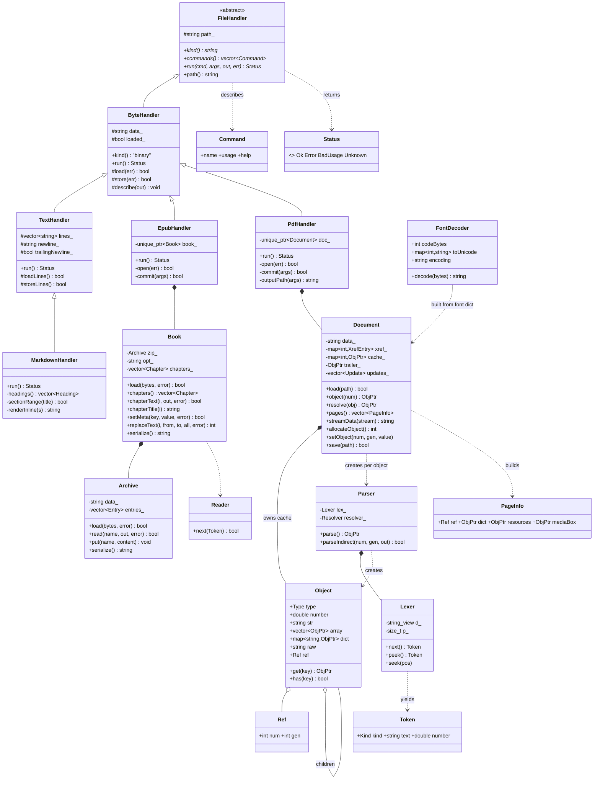

# anyfile — Object-Oriented Design

Companion to `SYSTEM_DESIGN.md`. That document describes layers and data flow; this one
describes the classes, how they relate, and which design patterns hold them together.
`blender_oop_design.py` renders the class diagram in Blender:

```
blender -b -P design/blender_oop_design.py -- --render design/oop_design.png
```

## 1. Class diagram



Free functions complete the picture: `makeHandler()` is the factory that returns a
`unique_ptr<FileHandler>`; `extractPageText()`, `replaceTextOnPage()` and `decodeStream()` are
stateless algorithms over `Document` and `Object`; the `make*()` helpers build `Object`s.

## 2. Responsibilities

| Class | Owns | Knows nothing about |
|---|---|---|
| `FileHandler` | the contract: a kind, a command list, a `run` | file contents, I/O |
| `ByteHandler` | raw bytes, atomic store, byte-level commands | lines, PDF structure |
| `TextHandler` | a line model with newline style | Markdown syntax |
| `MarkdownHandler` | headings, sections, rendering | PDF |
| `PdfHandler` | mapping CLI commands to `Document` calls | PDF syntax (delegated) |
| `EpubHandler` | mapping CLI commands to `Book` calls | zip or XML syntax (delegated) |
| `Book` | package file, spine, chapter text, metadata and text edits | how bytes are compressed |
| `Archive` | zip entries, checksums, copy-through rewrite | what the entries mean |
| `Reader` | XML tokens and their byte offsets | EPUB, document structure |
| `Document` | xref, object cache, page tree, incremental save | what the text means |
| `Parser` / `Lexer` | PDF syntax | file structure, filters |
| `Object` | one PDF value and its children | where it came from |
| `FontDecoder` | bytes → Unicode for one font | layout |

## 3. Patterns in use

- **Template Method / Chain of Responsibility** in `run()`. Each handler handles the commands it
  owns and forwards everything else to its base class (`MarkdownHandler::run` → `TextHandler::run`
  → `ByteHandler::run`). `Status::Unknown` surfaces only when no class in the chain claims the
  command, and `main` turns that into a usage error.
- **Factory** in `makeHandler()`. The registry inspects magic bytes and extension and returns the
  most specific handler as a `unique_ptr<FileHandler>`. `main` never names a concrete class.
- **Composite** in `Object`. Arrays and dictionaries hold `shared_ptr<Object>` children, so a whole
  PDF value tree is one recursive structure that `serialize()` and `describe()` walk uniformly.
- **Lazy loading with memoisation** in `Document::object()`. Objects are parsed on first use from
  their xref offset and cached; object streams are inflated once and cached as a unit.
- **Strategy** in `FontDecoder`. The content interpreter asks the current font to decode bytes; the
  decoder chosen (ToUnicode CMap, WinAnsi, MacRoman, 2-byte identity) is data, not a subclass.
- **Dependency injection** in `Parser`. A `Resolver` callback lets the parser look up an indirect
  `/Length` without depending on `Document`, which keeps `Parser` reusable for content streams
  and CMaps where no document exists.
- **Append-only persistence** in `Document::save()`. Queued `Update`s are serialized after the
  original bytes with a new xref; the loaded state is never mutated in place.

## 4. Invariants

- `Object::get()` never returns `nullptr`; absent keys yield a shared Null object, so call chains
  such as `doc.resolve(page->get("Resources"))->get("Font")` are safe without checks.
- `Document::resolve()` follows at most 32 reference hops and returns Null on cycles.
- A handler's `load()` reads the file at most once per process; `store()` writes through a temp
  file and `rename`, so the on-disk file is always either the old or the new version.
- `TextHandler` preserves CRLF vs LF and the presence of a trailing newline across every edit.
- `Document` never writes into `data_`; all edits live in `updates_` until `save()`.
- `Archive` never modifies the loaded bytes; `put()` stores new content beside them and
  `serialize()` builds a fresh archive, with `mimetype` kept stored so the result is still an EPUB.
- `Archive::read()` verifies the CRC of every entry it returns, so damage is reported, not shown.
- `Reader` tokens tile the source with no gaps for text and tags, so an edit made by byte offset
  cannot disturb neighbouring markup.

## 5. Extension points

| To add | Do |
|---|---|
| A new file type | subclass `ByteHandler` or `TextHandler`, override `commands()` and `run()`, add one branch in `makeHandler()` |
| A new PDF command | add a case in `PdfHandler::run()`; use `allocateObject()` / `setObject()` and `commit()` |
| A new EPUB command | add a case in `EpubHandler::run()`; edit through `Book`, then `commit()` |
| A new stream filter | add a branch in `decodeStream()` |
| A new font encoding | extend `FontDecoder::decode()` or `buildFontDecoder()` |

## 6. Known tension

Inheritance gives Markdown every text and byte command for free, but it also means
`PdfHandler` inherits line-oriented commands that make no sense for a PDF only because
`ByteHandler` does not have them. EPUB is the fifth type and follows the same shape as PDF: a thin handler over an engine. If a sixth type arrives, the cleaner shape is
composition: a handler holds a list of *capability* objects (`ByteOps`, `LineOps`,
`SectionOps`, `PdfOps`, `EpubOps`) and `run()` dispatches across them. The `commands()` listing is
already shaped so that change would be invisible at the CLI.
